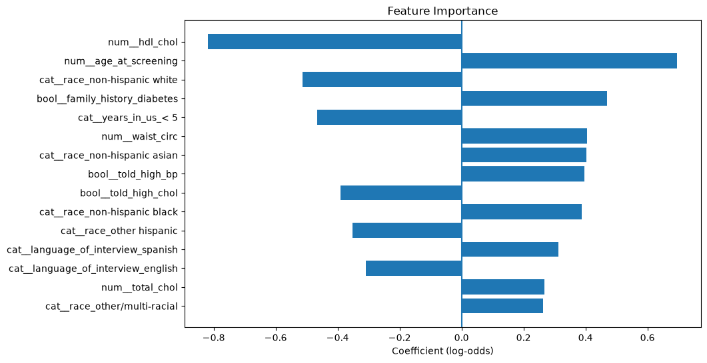
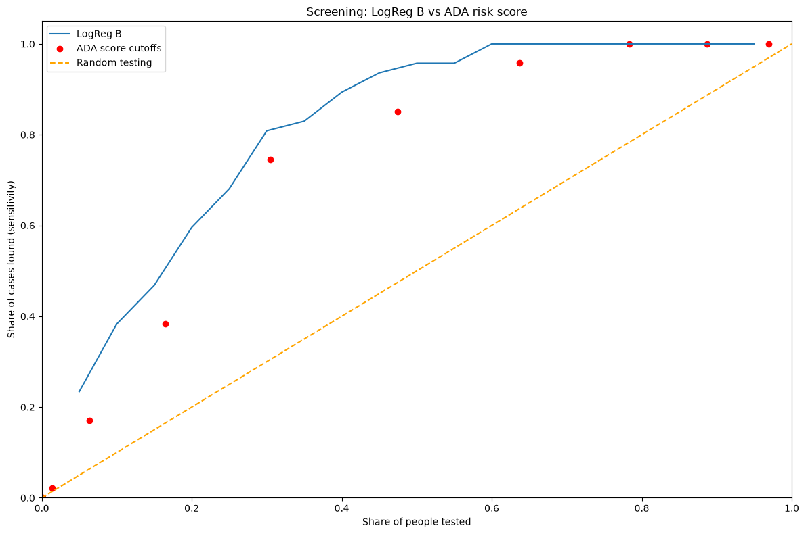
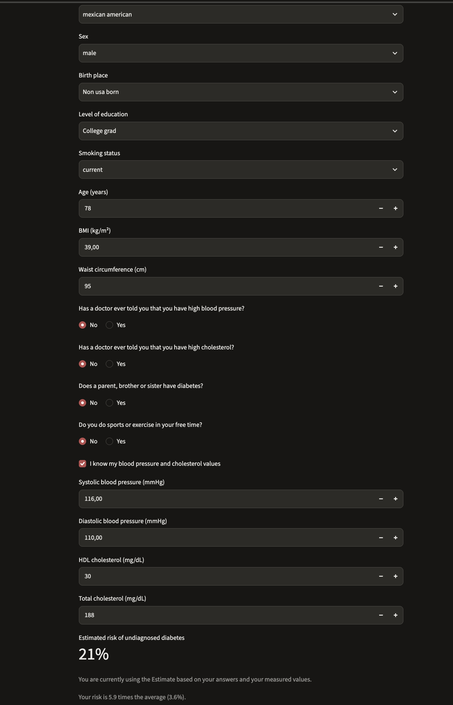

# Undiagnosed Diabetes Risk Model (NHANES)

A screening model that estimates the risk of **undiagnosed diabetes** in US adults, using public CDC NHANES data (2017–March 2020).

The question: from information you can collect in a short visit (age, waist, blood pressure, family history, and optionally a cholesterol test), can we find people who have diabetes but don't know it?

**Live app:** [nhanes-diabetes-risk.streamlit.app](https://nhanes-diabetes-risk.streamlit.app), a risk calculator based on the final model (see [App](#app)).

## Data

- **Source:** [NHANES 2017–March 2020 pre-pandemic](https://wwwn.cdc.gov/nchs/nhanes/continuousnhanes/default.aspx?Cycle=2017-2020), 12 public files (demographics, diabetes questionnaire, HbA1c, glucose, body measures, blood pressure, cholesterol, smoking, physical activity, medical conditions).
- **Target:** HbA1c ≥ 6.5% in a person who has **not** been told they have diabetes and takes no insulin or diabetes pills.
- **Sample:**

| Step | Rows |
|---|---|
| Participants with an HbA1c result | 9,737 |
| Aged 20+ | 8,081 |
| Not pregnant | 8,005 |
| Known diabetes status | 8,000 |
| **Not diagnosed (analysis sample)** | **6,644** |

237 people (3.6%) in the analysis sample have undiagnosed diabetes.

## Method

- **No leakage:** the diabetes questionnaire columns and HbA1c are not used as features.
- **Two feature sets:**
  - **Model A, no lab test:** demographics, body measures, blood pressure, history and lifestyle.
  - **Model B:** Model A plus total and HDL cholesterol (one blood test).
- **Models:** logistic regression and gradient boosting (scikit-learn pipelines with imputation, scaling and one-hot encoding).
- **Evaluation:** 80/20 stratified split. 5-fold stratified cross-validation on the training set for model choice, and the test set for final results.
- **Metrics:** ROC-AUC, PR-AUC (the baseline is the prevalence, 0.036) and the Brier score.

## Results

**Cross-validation (training set, 5 folds):**

| Model | ROC-AUC | PR-AUC |
|---|---|---|
| Logistic regression A | 0.76 ± 0.04 | 0.10 ± 0.03 |
| **Logistic regression B** | **0.80 ± 0.03** | **0.12 ± 0.04** |
| Gradient boosting A | 0.75 ± 0.03 | 0.11 ± 0.02 |
| Gradient boosting B | 0.76 ± 0.03 | 0.13 ± 0.03 |

- **Cholesterol helps:** adding one blood test raises ROC-AUC by about 0.04.
- **A more complex model didn't help:** gradient boosting was no better than logistic regression. With about 190 positive cases in training, the simple model generalizes better and is easier to explain. **Logistic regression B is the final model.**

**Test set (final model):** ROC-AUC 0.83, PR-AUC 0.14 (about 4× the baseline), Brier 0.032.

**Calibration:** predicted risks match the observed rates well (for example, a predicted risk of about 11% matches about 11% observed). Predictions only reach about 12%, and the test set has 47 positive cases, so the evidence is limited.


**Subgroups (test set, ROC-AUC):**

- **Sex:** women 0.86 and men 0.79. The groups are small (23 and 24 cases), so this difference is within noise.
- **Age:** 40–59 scored 0.83, but **60+ only 0.70**. The model is weakest in the oldest group, where most people already have several risk factors. The 20–39 group has only 4 cases, so its score is not reliable.
- **Race:** each group has 2–18 cases, which is too few to compare.

**Most important features (logistic regression B):**



- **HDL cholesterol is protective:** about 0.44× the odds per standard deviation.
- **Classic risk factors:** age (about 2× the odds per standard deviation, about 17 years), family history of diabetes (1.6×), waist circumference (1.5×) and diagnosed high blood pressure (1.5×).
- **"Told high cholesterol" lowers the risk** (0.68×). This is probably not biology. People with a cholesterol diagnosis see doctors more often, so their diabetes is more likely to be diagnosed already, and they leave the "undiagnosed" group.
- These are associations, not causes. Correlated features, such as BMI and waist, share their effect, so a small coefficient doesn't mean a feature is unimportant.

## Screening: who should be tested?

A risk score is only useful with a rule for who gets a blood test. On the test set (1,329 people, 47 hidden cases), I ranked people by model risk and compared the result with the **ADA diabetes risk test**, a simple points score that doctors already use. The score gives points for age, male sex, family history, high blood pressure, physical inactivity and BMI. A score of 5 or more means "test this person".

**Testing the top of the model's ranking:**

| People tested | Cases found | Tests per case found |
|---|---|---|
| Top 10% | 38% | 7 |
| Top 20% | 60% | 10 |
| Top 30% | **81%** | 11 |

Random testing needs about 28 tests per case found.

**Model vs ADA score, with the same number of tests (630 people, 47%):**

| | Cases found | ROC-AUC |
|---|---|---|
| ADA score ≥ 5 | 40 of 47 (85%) | 0.76 |
| **LogReg B** | **45 of 47 (96%)** | **0.83** |



- At every testing level, the model finds more cases than the ADA score.
- The model's top 30% finds almost as many cases (81%) as the ADA rule (85%), with about 37% fewer tests.
- The gap is 5 cases out of 47, so it is small in absolute terms. The higher cross-validation ROC-AUC of the model (0.80) supports the result.

## App

**[nhanes-diabetes-risk.streamlit.app](https://nhanes-diabetes-risk.streamlit.app)**



The app estimates a person's risk of undiagnosed diabetes from questions anyone can answer, and shows it compared with the average risk in the sample (3.6%). It is a portfolio project, not medical advice.

**Two input modes:**
- **Basic (14 inputs):** age, sex, race, birth place, education, smoking, BMI, waist, diagnosed high blood pressure or high cholesterol and their medication, family history of diabetes, and leisure-time activity.
- **With measurements (18 inputs):** the same, plus systolic and diastolic blood pressure, and total and HDL cholesterol. A checkbox switches to this mode.

**Fewer questions, nearly the same quality.** The full model uses 24 features, some of which are hard to know (income-to-poverty ratio) or are survey details (interview language, season of the exam). They were removed, and two slim models were compared with the full model on the same split (`src/04_app_model.ipynb`):

| Model | Inputs | CV ROC-AUC | Test ROC-AUC | Test PR-AUC | Test Brier |
|---|---|---|---|---|---|
| Full model | 24 | 0.797 | 0.828 | 0.141 | 0.032 |
| **With measurements** | 18 | **0.800** | **0.830** | **0.149** | 0.032 |
| Basic | 14 | 0.768 | 0.812 | 0.098 | 0.033 |

- The model with measurements is as good as the full model, so the removed features add nothing.
- Without measurements, the ranking (ROC-AUC) drops slightly, but the precision among the highest scores (PR-AUC) drops more. The app therefore recommends entering blood pressure and cholesterol.
- Both app models are well calibrated on the test set, so the shown percentages match observed rates.
- After evaluation, both models were refitted on all 6,644 participants and saved with `joblib` (`models/`).

**Limits of the app:**
- The calibration was checked only up to about 12% predicted risk. Very high estimates come from input combinations that few people in the data had, so they are less precise.
- Some features lower the estimate in a way that reflects access to healthcare, not biology. For example, people with a high cholesterol diagnosis see doctors more often, so their diabetes is more likely to be found already.
- The model learned associations in US adults from 2017–2020. It may not transfer to other countries or groups.
- Cholesterol is entered in mg/dL, the unit used by NHANES.

## Limitations

- Only 237 positive cases. Test results are based on 47 cases, so all numbers have wide uncertainty.
- The survey weights are not used. The results describe this sample, not the whole US population.
- A single HbA1c measurement. A clinical diagnosis normally needs a repeated test.
- Cross-sectional data: the model finds people who have diabetes now. It doesn't predict future diabetes.
- The ADA score is missing one item, gestational diabetes (1 point for women with a history of it), because that question was not loaded. This can slightly underrate the ADA score for women.

## Project structure

```
data/raw/              NHANES .xpt files (not in git, see below)
data/processed/        analysis_sample.parquet, test_predictions.parquet
src/01_load_and_clean.ipynb   load, clean, merge, build target and features
src/02_model.ipynb            models, cross-validation, calibration, subgroups, feature importance
src/03_screening.ipynb        screening thresholds and comparison with the ADA risk score
src/04_app_model.ipynb        slim models for the app: comparison, calibration, final fit
models/                       saved app models (basic_model.joblib, lab_model.joblib)
app/app.py                    Streamlit app
reports/figures/       saved plots
```

## How to run

1. Create an environment and install the packages:
```
pip install -r requirements.txt
```
2. Download the 12 files below into `data/raw/` from `https://wwwn.cdc.gov/Nchs/Data/Nhanes/Public/2017/DataFiles/<FILE>.xpt`

   P_DEMO, P_DIQ, P_GHB, P_GLU, P_BMX, P_BPXO, P_BPQ, P_TCHOL, P_HDL, P_SMQ, P_PAQ, P_MCQ

3. Run the notebooks in order: `src/01_load_and_clean.ipynb`, `src/02_model.ipynb`, `src/03_screening.ipynb`, `src/04_app_model.ipynb`
4. Start the app locally from the repo root: `streamlit run app/app.py`

## Stack

Python, pandas, NumPy, scikit-learn, matplotlib, Streamlit, joblib
